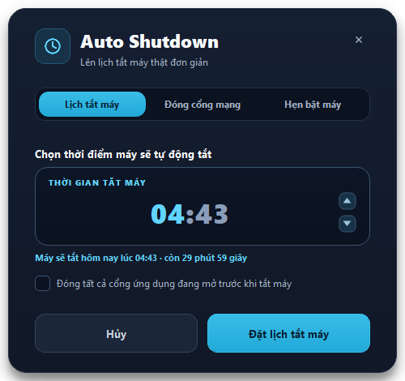
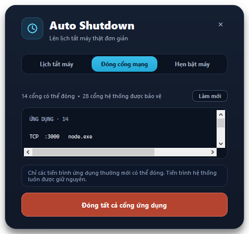
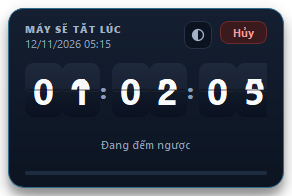

<div align="center">

# ⏰ Auto Shutdown

**Công cụ hẹn giờ tắt máy Windows — nhẹ, chạy ẩn, giao diện đẹp.**

[](https://www.python.org/)
[](https://pypi.org/project/PyQt5/)
[](https://github.com/iamhieuxz/autoshutdown/releases/latest)
[](LICENSE)
[](https://www.microsoft.com/windows)

</div>

---

## ✨ Tính năng

| | Tính năng | Mô tả |
|---|---|---|
| 🕐 | **Hẹn giờ tắt máy** | Chọn giờ tắt, tự động đếm ngược. Tự xử lý qua nửa đêm (đặt 02:30 lúc 22:20 → tắt lúc 02:30 hôm sau). |
| 🔌 | **Đóng cổng mạng** | Đóng toàn bộ cổng đang mở trước khi tắt máy. Tự bảo vệ các tiến trình hệ thống. |
| ⏰ | **Hẹn giờ bật máy** | Task Scheduler với `WakeToRun` — máy tự bật lại đúng giờ dù đã tắt hoàn toàn. |
| 🎨 | **Flip-clock đếm ngược** | Pop-up đồng hồ lật từng chữ số, neo ở góc dưới bên phải, kéo thả được. |
| 🎚️ | **Độ trong suốt** | Chỉnh 30%–100% cho pop-up đếm ngược, vị trí được ghi nhớ. |
| 🖥️ | **Chạy ẩn** | Nằm gọn trong system tray, không chiếm taskbar. |

---

## 📸 Giao diện

<div align="center">

### Lịch tắt máy



### Đóng cổng mạng



### Đếm ngược flip-clock



</div>

---

## 🚀 Cài đặt

## 📥 Tải về

<div align="center">

[](https://github.com/iamhieuxz/autoshutdown/releases/latest)
[](https://github.com/iamhieuxz/autoshutdown/releases)

</div>

### Cách 1: Tải file `.exe` (khuyến nghị)

1. Tải `AutoShutdown.exe` từ mục [Releases](https://github.com/iamhieuxz/autoshutdown/releases).
2. Copy ra Desktop và chạy.

> **Lưu ý:** Windows có thể hiện cảnh báo SmartScreen vì file không được ký số.
> Chọn **Thông tin thêm → Chạy dù sao**.

### Cách 2: Chạy từ mã nguồn

```bash
# Clone repository
git clone https://github.com/iamhieuxz/autoshutdown.git
cd autoshutdown

# Cài dependencies
pip install -r requirements.txt

# Chạy ứng dụng
python AutoShutdown.py
```

### Cách 3: Tự build

```bash
build.bat
```

File `.exe` sẽ nằm trong thư mục `dist/`.

---

## 📖 Hướng dẫn sử dụng

### Khởi động

Ứng dụng chạy ẩn trong **system tray** (góc phải thanh taskbar). Có thể ẩn icon trong khoảng `^`.

### Mở giao diện

- **Click đơn** hoặc **double-click** vào icon trong system tray, hoặc
- Chuột phải → **Đặt lịch tắt máy**

### Đặt lịch tắt máy

1. Chọn tab **Lịch tắt máy**.
2. Bấm vào phần **giờ** hoặc **phút** trên ô thời gian để chọn trường cần chỉnh.
3. Dùng mũi tên ▲▼ để điều chỉnh. Giờ vòng `0→23→0`, phút vòng `0→59→0`.
4. (Tùy chọn) Tick **"Đóng tất cả cổng ứng dụng đang mở trước khi tắt máy"**.
5. Bấm **Đặt lịch tắt máy**.

> Nếu giờ đã qua so với thời điểm hiện tại, lịch sẽ tự được đặt cho ngày hôm sau.

### Pop-up đếm ngược

Sau khi đặt lịch, một pop-up flip-clock xuất hiện ở **góc dưới bên phải**:

- **Kéo** để di chuyển — vị trí được ghi nhớ lại.
- **⚙** để chỉnh độ trong suốt.
- **Hủy** để hủy lịch tắt máy ngay lập tức.

### Đóng cổng mạng

Chuyển sang tab **Đóng cổng mạng** để xem toàn bộ cổng đang lắng nghe:

- Cổng **ứng dụng** (màu trắng) → có thể đóng.
- Cổng **hệ thống** (màu xám, ghi `[tiến trình hệ thống]`) → luôn được bảo vệ.

Bấm **Đóng tất cả cổng ứng dụng** để dọn dẹp ngay, hoặc tick ô trong tab *Lịch tắt máy* để tự động đóng đúng lúc tắt máy.

### Hẹn giờ bật máy

Chuyển sang tab **Hẹn bật máy**, chọn giờ rồi bấm **Hẹn giờ bật máy**.

Task được đăng ký với tên `AutoShutdown Auto Wake` trong Task Scheduler với các cờ:

| Cờ | Ý nghĩa |
|---|---|
| `WakeToRun` | Bật RTC alarm để đánh thức máy |
| `StartWhenAvailable` | Bật máy ngay cả khi lỡ mất giờ |
| `AllowStartIfOnBatteries` | Cho phép chạy cả khi dùng pin |

> ⚠️ **Yêu cầu:** Bật **Wake on RTC** trong BIOS/UEFI. Đa số mainboard desktop hỗ trợ,
> nhưng một số laptop và máy tính build sẵn không có.

---

## 🔐 An toàn

Ứng dụng **không bao giờ** đóng các tiến trình hệ thống. Cơ chế bảo vệ gồm 4 lớp:

1. **PID ≤ 4** — các tiến trình lõi của Windows.
2. **Danh sách tên bảo vệ** — `csrss`, `wininit`, `winlogon`, `services`, `lsass`, `svchost`, `dwm`, `spoolsv`...
3. **Đường dẫn trong thư mục Windows** — mọi tiến trình nằm trong `C:\Windows` đều được bảo vệ.
4. **Cổng hệ thống** — `135`, `137`, `138`, `139`, `445`, `5985`, `5986`, `47001`.

Việc đóng cổng thực hiện bằng `taskkill /F /T` (kill cả tiến trình con).

---

## 🧩 Cấu trúc dự án

```
autoshutdown/
├── AutoShutdown.py        # Điểm vào chính + toàn bộ giao diện Qt
├── port_cleaner.py        # Quét & đóng cổng mạng, logic bảo vệ tiến trình
├── wake_scheduler.py      # Đăng ký Task Scheduler để hẹn giờ bật máy
├── make_icon.py           # Sinh file icon.ico đa độ phân giải
├── build.bat              # Script build .exe
├── run.bat                # Script chạy nhanh
├── requirements.txt
└── icon.ico
```

### Design tokens

Toàn bộ giao diện dùng hệ thống token tập trung trong class `Token`:
lưới cách **4px**, bo góc thống nhất (8/12/16/22px), và bảng màu ngữ nghĩa
(`surface`, `border`, `text_primary`, `accent`, `danger`...). Sửa một chỗ là toàn bộ giao diện cập nhật.

---

## 🛠️ Công nghệ

- **Python 3.8+**
- **PyQt5** — framework GUI, vẽ flip-clock bằng `QPainter`
- **psutil** — lấy đường dẫn executable của tiến trình
- **PyInstaller** — đóng gói thành `.exe` chạy độc lập
- **Pillow** — sinh icon đa độ phân giải

---

## ⚙️ Cấu hình

Cài đặt được lưu tại `~/.autoshutdown_settings.json`:

```json
{
  "panel_pos": [749, 465],
  "panel_opacity": 100,
  "open_on_launch": false
}
```

| Khóa | Ý nghĩa |
|---|---|
| `panel_pos` | Vị trí pop-up đếm ngược |
| `popup_pos` | Vị trí cửa sổ chính |
| `panel_opacity` | Độ trong suốt pop-up đếm ngược (30–100) |
| `popup_opacity` | Độ trong suốt cửa sổ chính |
| `open_on_launch` | Mở cửa sổ ngay khi khởi động |

---

## ❓ Khắc phục sự cố

**Không thấy icon trong system tray**
→ Kiểm tra khoảng mũi tên `^` ở góc phải taskbar, hoặc kéo icon ra khỏi vùng ẩn.

**Không đóng được cổng nào**
→ Nhiều cổng thuộc tiến trình hệ thống — đây là hành vi đúng, nhằm tránh làm hỏng Windows.

**Máy không tự bật lại đúng giờ**
→ Kiểm tra BIOS có bật `Wake on RTC Alarm` / `Resume by RTC Alarm` không. Kiểm tra tại
`Task Scheduler → AutoShutdown Auto Wake → Properties` cờ **Wake the computer to run this task**.

**Windows báo "không thể đặt lịch"**
→ Chạy ứng dụng với quyền quản trị (Run as administrator).

---

## 📄 License

MIT License — xem [LICENSE](LICENSE).

---

<div align="center">

Made with ☕ using Python & PyQt5

</div>
